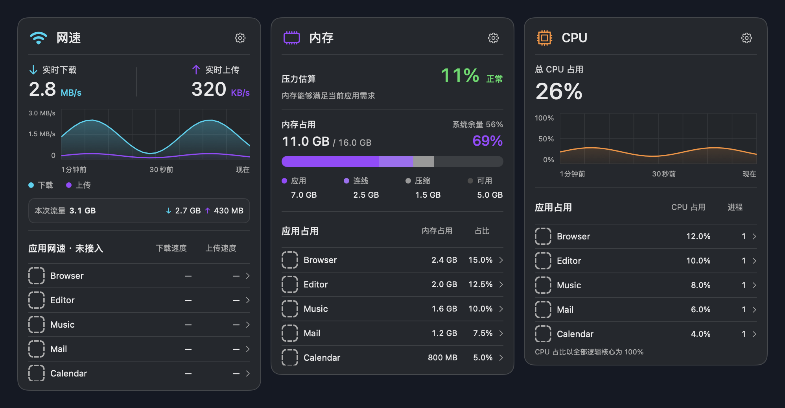
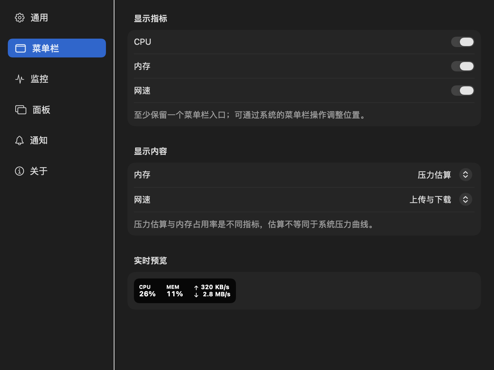
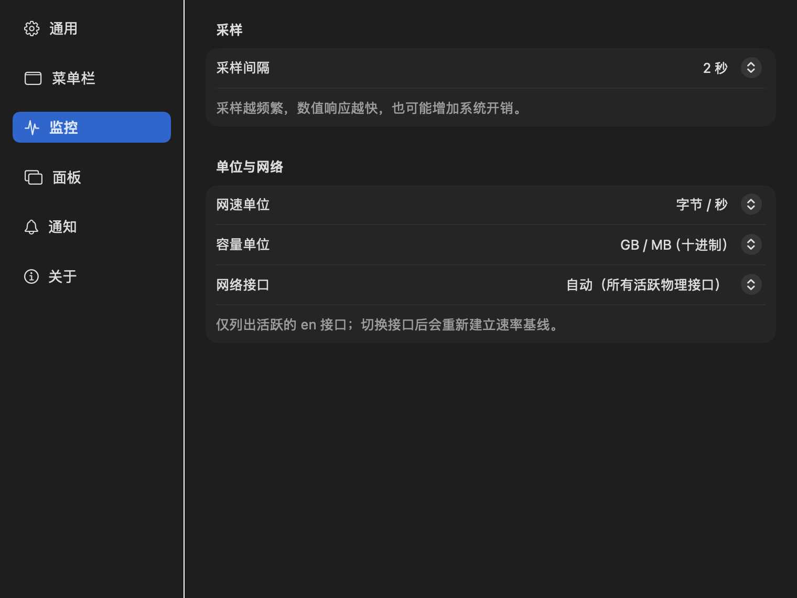

<div align="center">
  
  <h1>Kimo Monitor</h1>
  <p>一款原生、轻巧的 macOS 菜单栏系统监控工具。</p>
  <p>在菜单栏随时查看 CPU、内存和网速，点击即可展开详细信息。</p>
  <p><strong>macOS 14+</strong> · SwiftUI · 本地采样</p>
</div>

## 界面预览

三个独立面板展示实时网速、内存状态和 CPU 占用，也可以在设置中选择需要显示的菜单栏项目。



<details>
<summary>查看设置界面</summary>

**菜单栏设置**



**采样与网络设置**



</details>

> 图片使用应用视图生成，数值和应用名称为演示数据；实际界面显示本机实时数据。

## 功能

- **菜单栏监控**：独立显示 CPU、内存和网速，按需隐藏或调整显示内容。
- **实时详情**：查看 CPU 与网络趋势、内存分类和压力等级，以及 CPU、内存占用较高的应用。
- **灵活设置**：调整采样间隔、图表时间范围、排行榜数量、网络接口、显示单位与面板主题。
- **异常提醒**：可选择开启 CPU 持续高占用和系统内存压力提醒，并设置重复提醒间隔。
- **本地运行**：采样与计算在本机完成；设置保存在本机，历史图表仅保存在运行期间的内存中。

## 开始使用

### 环境要求

- 运行环境：macOS 14 或更高版本。
- 从源码构建：包含 macOS 27 SDK 的 Xcode 27 或更高版本。项目不依赖第三方运行时。

### 从源码构建

```bash
git clone https://github.com/kimo-si/kimo-monitor.git
cd kimo-monitor
xcodebuild -project KimoMonitor.xcodeproj -scheme KimoMonitor \
  -configuration Release -derivedDataPath build build
open "build/Build/Products/Release/Kimo Monitor.app"
```

也可以使用 Xcode 打开 `KimoMonitor.xcodeproj`，选择 `KimoMonitor` scheme 后运行。当前仓库提供源码；构建产物的签名和分发需要根据自己的环境配置。

### 第一次打开

1. 在 macOS 菜单栏找到 **CPU、MEM 和网速**，点击其中任意一项打开详情。
2. 点击详情面板右上角的齿轮，选择 **打开设置…**。
3. 根据需要调整菜单栏显示、采样间隔和面板主题。开启提醒时，macOS 会请求通知权限。

应用正常启动时以菜单栏项目运行。需要同时查看三个面板时，可在齿轮菜单中选择 **打开实时对照总览**，或在启动时传入 `--preview`：

```bash
open "build/Build/Products/Release/Kimo Monitor.app" --args --preview
```

## 设置一览

| 页面 | 可以调整的内容 |
| --- | --- |
| 通用 | 登录时启动、启动时打开实时总览、恢复默认设置。登录启动可能需要在系统设置中批准。 |
| 菜单栏 | CPU、内存和网速的显示；内存指标、网络方向及实时预览。至少保留一个入口。 |
| 监控 | 采样间隔、网速和容量单位，以及自动或指定的活跃 `en` 网络接口。 |
| 面板 | 深色、浅色或跟随系统；趋势图、应用列表、时间范围和排行数量。 |
| 通知 | CPU 持续高占用、系统内存压力及重复提醒间隔。默认关闭。 |
| 关于 | 版本、实时总览与统计口径。 |

默认每 **2 秒**采样一次，图表展示最近 **1 分钟**，应用排行展示 **5 项**。增加图表时间范围后，数据从调整时开始积累。

## 数据口径与当前限制

- **CPU**：系统 CPU 占用以全部逻辑核心为 100%；进程 CPU 也按全部逻辑核心归一化。新进程需要等待第二次采样才能计算占比。
- **内存**：面板分别展示应用、连线、压缩及可用内存。菜单栏可选择压力估算、占用率或已用容量。
- **压力估算**：计算方式是「压缩内存 ÷（物理内存 − 连线内存）」。它是自定义估算，不是活动监视器的原生压力曲线；系统报告的压力等级会单独展示。
- **网络**：默认汇总处于 UP/RUNNING 状态的 `en` 接口，也可选择其中一个活跃接口；统计包含链路开销，不代表应用有效载荷。虚拟隧道与回环不计入该汇总。
- **本次流量**：只累计应用运行期间实际观测到的增量，不补算休眠、未运行、接口切换或采样失败期间无法确认的数据。切换接口前后的已观测流量会继续累计在本次运行中。
- **应用网速尚未接入**：网络面板中的应用列表按内存排序，网速显示 `—`，不代表网络排行。
- **权限与缺失值**：无法读取或尚未完成差分采样时显示 `—`；进程采集受系统权限和采样间隔限制。系统唤醒后会重新建立差分基线。

<details>
<summary>查看实现与系统数据来源</summary>

系统调用、差分、应用聚合和排序在同一条后台串行队列执行，主线程发布不可变快照。菜单栏使用独立的原生状态项，图像在显示文字未变化时复用缓存。

| 指标 | 实现 |
| --- | --- |
| 网络速率 | 通过 `NET_RT_IFLIST2` 读取 64 位接口字节计数，以增量除以实际采样间隔。 |
| 系统 CPU | 使用 `HOST_CPU_LOAD_INFO` 的忙碌 tick 增量与总 tick 增量计算。 |
| 进程 CPU 与内存 | 使用 `proc_pid_rusage`，按可执行文件所属的最外层 `.app` 路径聚合可访问进程。 |
| 系统内存 | 已使用内存为应用、连线与压缩三部分的合计；缓存另计，避免重复累计。 |
| 系统内存压力与余量 | 分别读取 `kern.memorystatus_vm_pressure_level` 和 `kern.memorystatus_level`。 |

相关系统源码：[XNU 内存压力与余量](https://github.com/apple-oss-distributions/xnu/blob/main/doc/vm/memorystatus_notify.md)、[内存页定义](https://github.com/apple-oss-distributions/xnu/blob/main/osfmk/mach/vm_statistics.h)、[进程资源记账](https://github.com/apple-oss-distributions/xnu/blob/main/osfmk/kern/bsd_kern.c) 和 [memory_pressure 工具](https://github.com/apple-oss-distributions/system_cmds/blob/main/memory_pressure/memory_pressure.c)。

</details>

## 开发与验证

```bash
python3 Tests/run_checks.py
```

检查覆盖采样边界、CPU 校准、后台发布、设置与通知规则、菜单栏渲染和交互，以及面板布局。运行结果写入本地 `artifacts/validation.txt`；报告中的耗时仅代表当前机器。

`project.yml` 是 XcodeGen 项目定义。增删源码文件后，安装 XcodeGen 并运行 `xcodegen generate`，以更新 `KimoMonitor.xcodeproj`。
